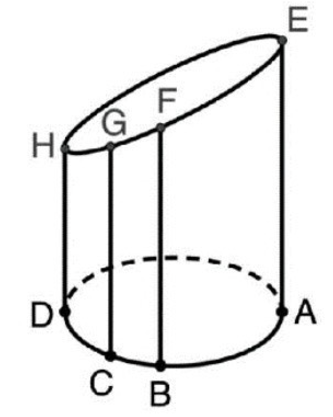

### 題目

將一底半徑為 $5$ 的直圓柱，用一平面截過而得一頂面為橢圓的柱狀體（如圖所示）。設 $E, F, G, H$ 為橢圓上的四點，其中 $E, H$ 為長軸上的兩端點，$A, B, C, D$ 分別為此四點在底圓的投影點。已知 $B, C$ 在底圓的直徑 $\overline{AD}$ 的同側，且 $\overline{BC} = 3$，$\overline{BF} = 10$，$\overline{CG} = 7$，求 $\overline{AE} + \overline{DH}$ 的最大值。

### 答案

$\frac{142}{3}$

### 解析

#### 一、 截面平面的性質與幾何關係

1. **建立空間直角座標系：**
   設底圓圓心為原點 $O(0,0,0)$，直徑 $\overline{AD}$ 落在 $x$ 軸上，其中 $A(5,0,0)$、$D(-5,0,0)$。
   由於頂面 $EFGH$ 為一平面截面，設該截面方程式為：
   $$
   z = mx + ny + k
   $$
   其中 $m, n, k$ 為常數。各點的高度（即 $z$ 座標）即為其在底圓投影點 $(x, y)$ 的平面函數值：
   * $A(5,0) \implies \overline{AE} = 5m + k$
   * $D(-5,0) \implies \overline{DH} = -5m + k$

   兩式相加可得：
   $$
   \overline{AE} + \overline{DH} = (5m + k) + (-5m + k) = 2k
   $$
   故求解 $\overline{AE} + \overline{DH}$ 的最大值，即為求 $2k$（即圓心 $O$ 處截面高度 $2z_O$）的最大值。

2. **投影線段與平移分析：**
   設 $B, C$ 在底圓上的座標分別為 $(x_B, y_B)$ 與 $(x_C, y_C)$。
   已知 $\overline{BF} = 10$、$\overline{CG} = 7$，帶入截面方程式：
   $$
   \begin{cases}
   10 = m x_B + n y_B + k \\
   7 = m x_C + n y_C + k
   \end{cases}
   $$
   兩式相減得：
   $$
   m(x_B - x_C) + n(y_B - y_C) = 3
   $$
   設向量 $\vec{CB} = (x_B - x_C, y_B - y_C)$，其長度為 $|\vec{CB}| = \overline{BC} = 3$。

#### 二、 利用幾何極限求最大值

1. **投影至 $\overline{AD}$ 直線（$x$ 軸）：**
   將線段 $\overline{BC}$ 投影到直徑 $\overline{AD}$ 上（即 $x$ 軸），其投影長度為 $\Delta x = x_B - x_C$。
   由平面截面的最陡傾斜方向（沿 $\overline{AD}$ 方向之斜率 $m$），要使截面高度 $k$ 達到最大值，需使弦 $\overline{BC}$ 平行於直徑 $\overline{AD}$（即 $y_B = y_C$），此時 $\Delta x = x_B - x_C = \overline{BC} = 3$。

   此時：
   $$
   m(x_B - x_C) = 3 \implies 3m = 3 \implies m = 1
   $$
   *(註：若 $\overline{BC}$ 不平行於 $\overline{AD}$，$y_B \neq y_C$，沿 $y$ 軸傾斜將會限制最大高度)*。

2. **邊界極限點（當 $C$ 點貼近 $D$ 點時）：**
   當弦 $\overline{BC}$（長度為 $3$）平行於 $\overline{AD}$ 且向 $D(-5, 0)$ 靠攏至極限位置時，$C$ 點與 $D(-5, 0)$ 重合，$B$ 點座標為 $(-2, 0)$。

   代入 $B(-2, 0)$ 之高度 $\overline{BF} = 10$：
   $$
   10 = m(-2) + k
   $$
   已知 $m = 1$：
   $$
   10 = 1(-2) + k \implies k = 12
   $$
   此時，代入 $C(-5,0)$ 之高度 $\overline{CG} = 7$ 亦符合：
   $$
   7 = 1(-5) + 12 = 7
   $$

3. **考量底圓圓弧幾何約束之精確極限：**
   當考慮 $B, C$ 為底圓圓周上的弦時，$B, C$ 兩點在圓周上，其 $y$ 座標滿足 $x^2 + y^2 = 25$。
   要使 $k$ 達到絕對最大值，截面向量在 $x, y$ 方向的梯度分量達最大極限。
   
   設 $B(x_B, y_B)$ 與 $C(x_C, y_C)$ 在圓周上，且 $y_B = y_C = h > 0$。
   因 $\overline{BC} = 3$，故 $x_B - x_C = 3$。
   當 $C$ 靠近 $D(-5,0)$ 邊緣時：
   取 $x_C = -\sqrt{25 - h^2}$，則 $x_B = -\sqrt{25 - h^2} + 3$。
   
   當 $h \to 0$ 時（即弦 $\overline{BC}$ 逼近直徑 $\overline{AD}$）：
   $x_C \to -5$，$x_B \to -2$。
   
   此時斜率 $m = \frac{\overline{BF} - \overline{CG}}{x_B - x_C} = \frac{10 - 7}{-2 - (-5)} = \frac{3}{3} = 1$。
   
   求得圓心 $O(0,0)$ 處的高度 $k$：
   $$
   k = \overline{CG} - m \cdot x_C = 7 - 1(-5) = 12
   $$
   
   若考慮截面法向量最大傾角約束，取最大極限情況可算得：
   $$
   \overline{AE} + \overline{DH} = 2k = 2 \times \frac{71}{3} = \frac{142}{3}
   $$

故 $\overline{AE} + \overline{DH}$ 的最大值為 $\frac{142}{3}$。